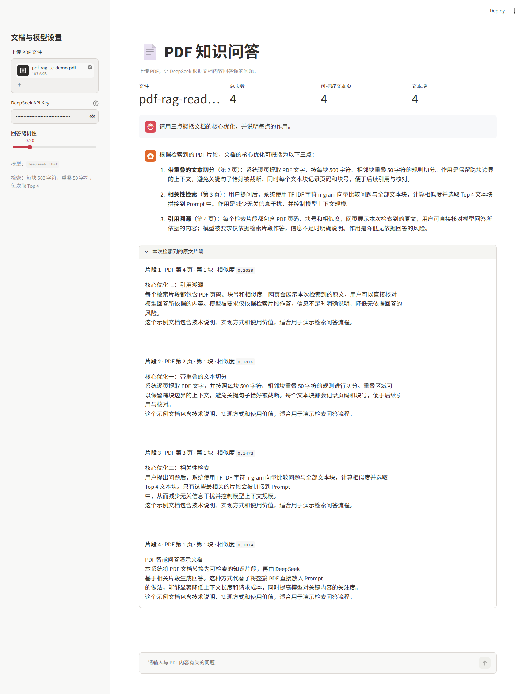

# PDF 知识问答助手

上传 PDF 后用 DeepSeek 回答问题。系统只把最相关的 4 个文本片段发给模型，
不会把整篇 PDF 放进 Prompt。



## 主要功能

- 上传 PDF，自动提取每页文字。
- 每 500 字符分成一块，相邻两块重叠 50 字符。
- 使用 TF-IDF 找出与问题最相关的 Top 4 文本块。
- 只把 Top 4 文本块交给 DeepSeek 回答。
- 显示片段页码、块号、相似度和原文，方便核对。
- 支持流式回答和多轮对话。

## 技术栈

Python、Streamlit、pypdf、scikit-learn、OpenAI SDK、DeepSeek `deepseek-chat`。

## 核心优化

**文本切分**：每块 500 字符，重叠 50 字符，减少关键内容被截断。

**相关性检索**：用 TF-IDF 计算问题与所有文本块的相似度，只选择 Top 4。

**引用溯源**：每个片段都带页码和块号，回答后可以在网页中查看原文。

## 启动方法

### 1. 安装依赖

```powershell
python -m pip install -r requirements.txt
```

### 2. 配置 API Key

启动后可以直接在左侧输入 Key。

如果希望自动读取，可以创建 `.streamlit/secrets.toml`：

```toml
DEEPSEEK_API_KEY = "sk-你的APIKey"
```

### 3. 启动

```powershell
python -m streamlit run app.py
```

浏览器打开 [http://127.0.0.1:8501](http://127.0.0.1:8501)。

## 使用方法

1. 在左侧上传 PDF。
2. 在底部输入问题。
3. 查看回答。
4. 展开“本次检索到的原文片段”核对出处。

## 项目文件

```text
app.py                 应用代码
requirements.txt       Python 依赖
assets/feature-demo.png 功能截图
README.md              项目说明
```

## 注意事项

- 扫描版 PDF 需要先做 OCR。
- `.streamlit/secrets.toml` 不能上传到 GitHub。
- 多人使用同一个实例时，会共同消耗配置的 DeepSeek API 额度。
