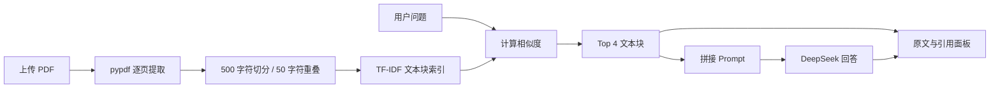

# PDF 知识问答助手

一个基于 Python、Streamlit 和 DeepSeek 的轻量级 PDF 检索问答应用。应用会从 PDF
中提取文字，通过带重叠的文本切分和 TF-IDF 相关性检索找出最相关的片段，再把这些
片段交给 DeepSeek 回答用户问题。

与将整篇 PDF 直接放入 Prompt 相比，这种方式能够减少无关上下文、降低请求成本，
并为回答保留可核对的页码和文本块来源。

## 功能截图


截图中包含 PDF 上传、文档统计、模型回答，以及 Top 4 检索片段和相似度展示。

## 主要功能

- 在侧边栏上传 PDF，并使用 `pypdf` 逐页提取文字。
- 按每块 500 字符、相邻块重叠 50 字符的规则切分文本。
- 为每个文本块保留 PDF 页码和块号。
- 使用 `TfidfVectorizer` 计算用户问题与文本块的相似度。
- 每次只检索 Top 4 相关片段，避免将整篇文档发送给模型。
- 通过 OpenAI SDK 调用 DeepSeek `deepseek-chat` 接口。
- 流式显示回答，并保留最近几轮对话上下文。
- 在可折叠面板中展示本次检索到的原文、页码、块号和相似度。
- 支持环境变量或 Streamlit Secrets 保存 API Key。

## 技术栈

| 组件 | 用途 |
| --- | --- |
| Python | 应用与检索逻辑 |
| Streamlit | 网页界面、文件上传和会话状态 |
| pypdf | PDF 逐页文字提取 |
| scikit-learn | TF-IDF 向量化与相似度计算 |
| OpenAI Python SDK | 调用 OpenAI 兼容接口 |
| DeepSeek API | 使用 `deepseek-chat` 生成回答 |

## 核心优化点

### 1. 带重叠的文本切分

每页文字独立切分，每个文本块最多包含 500 个字符。相邻文本块共享 50 个字符，
切分步长为 450 个字符。

```text
块 1：[0 -------------------- 500)
块 2：             [450 ------------------- 950)
块 3：                          [900 ------------------ 1400)
```

重叠区域能够保留跨越边界的上下文，减少关键句子被截断后语义丢失的问题。每个块同时
记录 `page_number` 和 `chunk_number`，为后续引用溯源提供依据。

### 2. 相关性检索

应用会为全部文本块建立 TF-IDF 索引，并将用户问题转换为同维度向量。两者相乘后得到
每个文本块的相似度，随后只选择得分最高的 4 个片段。

```text
PDF 文本块 ──> TfidfVectorizer.fit_transform() ──> 文档矩阵
用户问题   ──> TfidfVectorizer.transform()      ──> 问题向量
文档矩阵 × 问题向量 ──> 相似度 ──> Top 4 文本块
```

这里使用字符级 `1-3` gram，而不是仅按空格分词，因此能够较好地处理中文 PDF、英文 PDF
以及中英文混排内容。

### 3. 引用溯源

发给 DeepSeek 的 Prompt 仅包含本次选中的 4 个片段，每个片段带有：

- PDF 页码
- 页内文本块编号
- 原文内容

回答完成后，网页的“本次检索到的原文片段”面板会展示相同片段及相似度。用户可以据此
核对模型实际参考了哪些内容。系统提示同时要求模型仅依据检索片段回答，信息不足时必须
明确说明，降低无依据回答的风险。

## 数据流程



## 快速开始

### 1. 安装依赖

```powershell
cd C:\Users\Administrator\Desktop\my-rag-assistant
python -m pip install -r requirements.txt
```

### 2. 配置 API Key

推荐将 Key 保存为 Windows 用户环境变量：

```powershell
$secureKey = Read-Host "请输入 DeepSeek API Key" -AsSecureString
$plainKey = [System.Net.NetworkCredential]::new("", $secureKey).Password
[Environment]::SetEnvironmentVariable("DEEPSEEK_API_KEY", $plainKey, "User")
Remove-Variable secureKey, plainKey
```

也可以创建 `.streamlit/secrets.toml`：

```toml
DEEPSEEK_API_KEY = "sk-你的APIKey"
```

不要把真实 API Key 写入 `app.py` 或提交到版本仓库。

### 3. 启动应用

```powershell
python -m streamlit run app.py
```

浏览器访问：

```text
http://127.0.0.1:8501
```

## 使用方法

1. 在左侧上传 PDF。
2. 确认侧边栏显示模型名、文本块大小、重叠大小和 Top 4 配置。
3. 在底部输入与 PDF 内容相关的问题。
4. 查看流式生成的回答。
5. 展开“本次检索到的原文片段”，核对页码、块号、相似度和原文。

## 项目结构

```text
my-rag-assistant/
├── app.py                     # Streamlit 应用与全部检索问答逻辑
├── requirements.txt           # Python 依赖
├── README.md                  # 项目说明
└── assets/
    └── feature-demo.png       # 功能截图
```

## 设计说明

- 文本块大小：`CHUNK_SIZE = 500`
- 相邻块重叠：`CHUNK_OVERLAP = 50`
- 检索数量：`TOP_K = 4`
- 向量方式：字符级 TF-IDF，`ngram_range=(1, 3)`
- 模型：`deepseek-chat`
- PDF 文本与 API Key 不会写入应用内的持久化数据库

## 已知限制

- 扫描件或纯图片 PDF 没有可提取文字，需要先使用 OCR。
- TF-IDF 更擅长字面相关性；如果问题与原文用词差异很大，召回效果可能有限。后续可替换为
  向量嵌入检索或混合检索。
- 当前上传文件属于单个浏览器会话，不提供多人共享文档库。
- 如果多人访问同一个已配置 Key 的实例，他们会共用该 Key 的配额，因此公开部署前应增加
  登录、访问控制或服务端限流。

